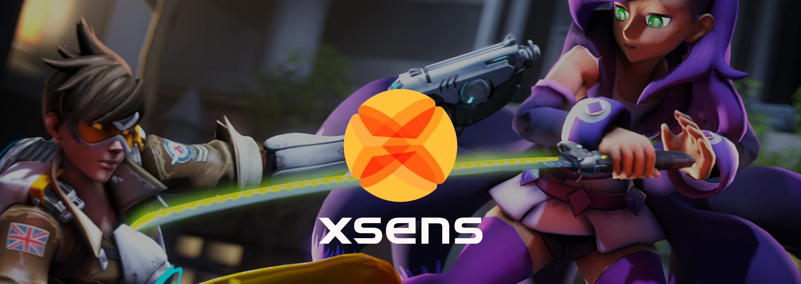
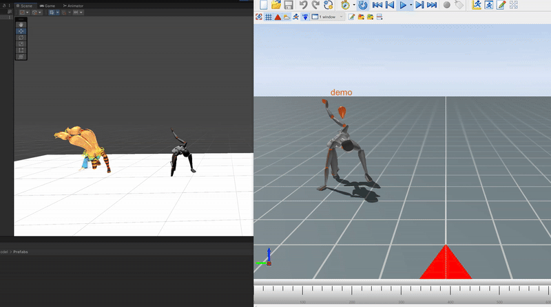
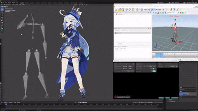
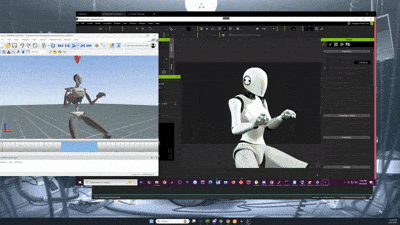
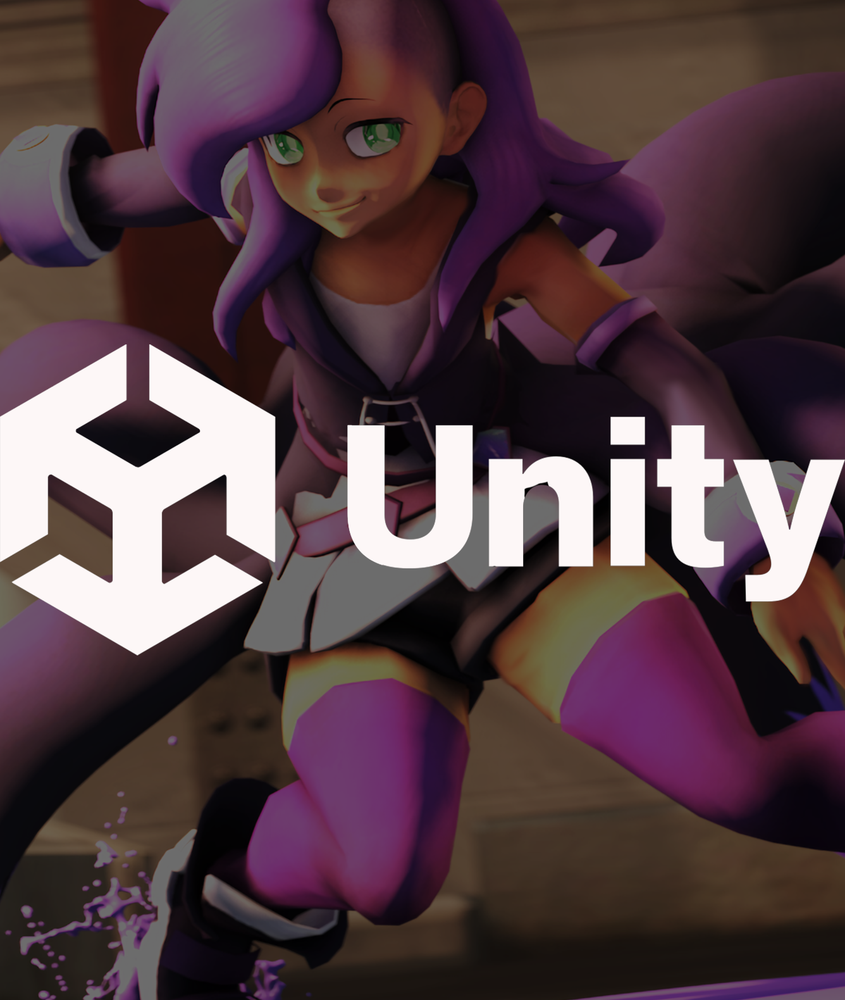

<p align="center">
  
</p>

<h1 align="center">XSENS MVN Live Stream Plugin</h1>

<p align="center">
  <b>Stream Xsens MVN mocap into Unity, Blender, Maya and iClone, record, export BVH, and now reprocess your recordings offline.</b>
</p>

<p align="center">
  <a href="https://moliminous.itch.io/xsens"></a>
  
  
  
</p>

<p align="center">
  <a href="../../issues/new?template=bug_report.yml">🐞 Report a bug</a> ·
  <a href="../../issues/new?template=feature_request.yml">✨ Request a feature</a> ·
  <a href="CHANGELOG.md">📜 Updates</a> ·
  <a href="https://www.youtube.com/watch?v=l5t6nejf86s">▶️ Video</a>
</p>

---

> [!WARNING]
> **This plugin is in active development (beta).** I fix things as I go, but updates don't follow a fixed schedule. Only buy it if you're OK with that.

## 🎬 In action

<p align="center">
  
</p>
<p align="center">
  
  &nbsp;
  
</p>

## ✨ What it does

<table>
<tr>
<td width="62%" valign="top">

| | |
| --- | --- |
| 📡 **Live streaming** | Pipe Xsens MVN data into **Unity, Blender, Maya and iClone** |
| 🎥 **Record & export** | Record takes, export **FBX**, or export **BVH** straight from the app |
| 🧍 **VTubing** | Go full-on VTuber with live streaming |
| 🔁 **Reprocess MVN** | **New:** re-solve a recorded `.mvn` offline into a cleaner new file, with a progress bar and cancel |
| 📐 **Euler output** | Euler rotation format (optional, paid add-on) |

**What it's NOT:** an exploit for MVN. You're still on the free plan, with whatever limits that has.

</td>
<td width="38%" valign="top">

</td>
</tr>
</table>

## 🔁 Reprocess MVN File (new)

Click **REPROCESS MVN FILE…** in the plugin window, pick a recording, then choose where to save the result.

- Always writes a **new file** (default `<name>_reprocessed.mvn`). Your original recording is **never** changed.
- Runs fully offline with a native solver. No Python and no Xsens SDK needed. A typical recording takes about 5 minutes.
- In our tests, foot contacts and root drift were very close to MVN's own reprocessing: under 1 cm RMS position and under 1° orientation.
- Keep the `MvnReprocess` folder next to `BipedStreamerPlugin.dll`.

## 📦 Install

<details open>
<summary><b>MVN 2024.2 and below</b></summary>

1. Copy the contents of the `plugins` folder from the download into your MVN plugin folder, e.g.
   `C:\Program Files\Xsens\Xsens MVN 2024.2\MVN\plugins`
2. Edit `ogre_plugin.cfg` and add:
   ```
   Plugin=BipedStreamerPlugin
   ```
3. Right-click the MVN `.exe` → **Properties → Compatibility → Run as administrator**.
4. Profit (?)

</details>

<details>
<summary><b>MVN 2025 and above</b></summary>

1. Copy the contents of the `plugins` folder from the **2025** download into your MVN plugin folder.
2. Edit `ogre_plugin.cfg` and add:
   ```
   Plugin=BipedStreamerPlugin
   ```
3. Overwrite `RenderSystem_Direct3D11.dll` with the version included in the download.
4. Right-click the MVN `.exe` → **Properties → Compatibility → Run as administrator**.
5. The GUI stays black until a scene is loaded or mocap is started. That's expected.

</details>

> [!NOTE]
> **Blender** requires our slightly modified **MVNBlenderPlugin** (included in the download) instead of the vanilla one.

Your folder should end up like this:

```
MVN\plugins\
├── BipedStreamerPlugin.dll
└── MvnReprocess\
    ├── MvnReprocess.dll
    ├── mvnr_defaults.bin
    └── ...support DLLs
```

## 🐞 Bugs, issues & feature requests

This repo is the home for **bug reports, feature requests and update notes**. It doesn't contain the source code.

| I want to… | Go here |
| --- | --- |
| Report something broken | [**New bug report**](../../issues/new?template=bug_report.yml) |
| Ask for a feature | [**New feature request**](../../issues/new?template=feature_request.yml) |
| See what changed | [**CHANGELOG.md**](CHANGELOG.md) |
| Buy / download | [**moliminous.itch.io/xsens**](https://moliminous.itch.io/xsens) |

When reporting a bug, please include your **MVN version**, **plugin variant** (2024/2025, base/Euler), what you were streaming to, and the steps to reproduce it. A log or screenshot helps a lot.

---

<p align="center">
  <sub>Made by <a href="https://moliminous.itch.io">moliminous</a> · Not affiliated with Movella / Xsens · No generative AI was used in the plugin's content</sub>
</p>
